# BB Blues Jam

App Android para organizar la **BB Blues Jam**, la jam de blues mensual de Bahía Blanca Blues.
Por fecha participan entre 20 y 60 músicos.

El organizador arma y publica la lista de temas. Los músicos la consultan desde el teléfono: qué
se toca, en qué tonalidad y en qué tema hay lugar para su instrumento. Para el organizador hay
además un **asistente con IA** que arma listas a partir del repertorio propio de la jam.

> Proyecto final del curso **AI Expert** de DevExpert (edición septiembre 2026). El proceso de
> desarrollo con IA y el harness están en [`docs/entregable-harness-ia.md`](docs/entregable-harness-ia.md).

## El problema

Hasta ahora la lista se armaba a mano y circulaba por WhatsApp o en papel:

- El músico no sabía de antemano qué se tocaba ni en qué tonalidad, así que no podía prepararse.
- No había forma de ver dónde había lugar. Si sos bajista, no sabías en qué temas faltaba bajo.
- La lista cambiaba hasta último momento y no había una versión única confiable.
- No quedaba registro de las jams anteriores, así que las listas se repetían sin querer.
- Armar una lista llevaba tiempo y un conocimiento del repertorio que solo tenía el organizador.

La app resuelve los cuatro primeros puntos y el asistente, el quinto.

## Una sola app, dos roles

| | Músico | Admin (organizador) |
|---|---|---|
| Ver la próxima jam, la lista, las tonalidades y los cupos | ✓ | ✓ |
| Filtrar por cupo libre | ✓ | ✓ |
| Ver jams anteriores | ✓ | ✓ |
| Armar la lista: agregar, quitar, ordenar, tonalidad, formación, anotar músicos | | ✓ |
| Crear, editar, borrar y publicar jams | | ✓ |
| Asistente con IA | | ✓ |

El admin no usa otra app ni otras pantallas: usa las mismas que el músico, con controles extra. No
hay botón de admin a la vista. Para entrar, se toca **5 veces seguidas el logo de Bahía Blanca
Blues en Info** y se escribe la frase de acceso. Para salir, otros 5 taps en el mismo logo. En modo
admin el fondo pasa a ser color vino y aparece arriba la franja **MODO ADMIN**, así nadie publica
algo creyendo que está en la vista de músico.

## Vista de músico

### Próxima jam

| 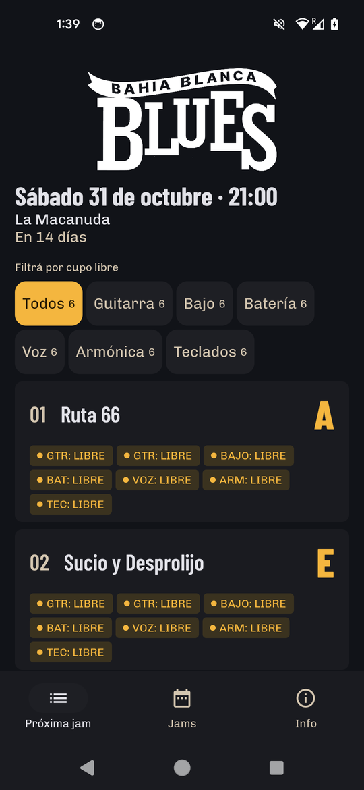 | 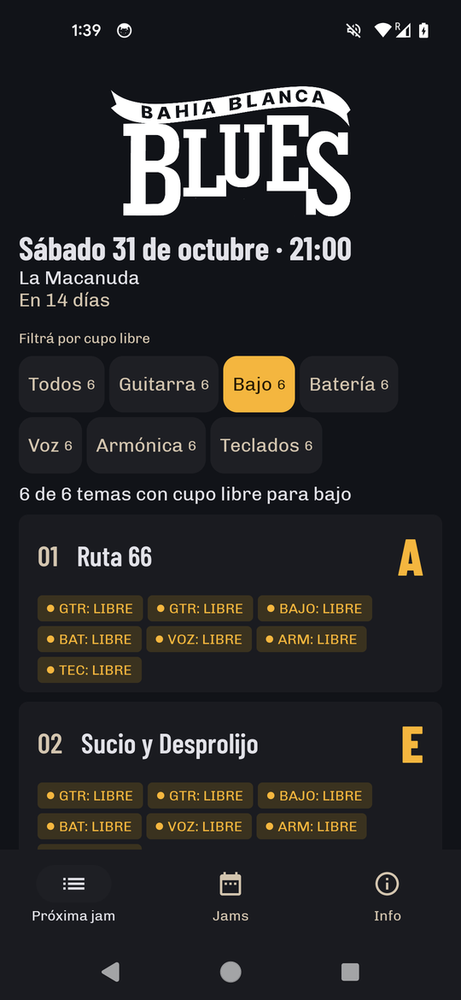 |
|:---:|:---:|

- **Encabezado:** fecha, hora y lugar, y cuánto falta ("En 14 días"). El lugar lo trae cada jam,
  porque puede cambiar.
- **Lista colapsada:** cada tema muestra la posición, el título, la **tonalidad en grande**
  (el dato más buscado) y una tira de cupos por instrumento. Cada cupo dice `GTR: LIBRE` en ámbar
  o tiene el nombre del músico en gris. La tira contesta "¿dónde puedo tocar?" sin abrir nada.
- **Filtro por cupo libre:** Guitarra, Bajo, Batería, Voz, Armónica y Teclados. Se pueden elegir
  varios a la vez y la lógica es "cualquiera". Por ejemplo, el filtro muestra "3 de 13 temas con
  cupo libre para bajo o voz". Si ningún tema tiene lugar, lo dice y ofrece volver a la lista
  completa.
- **Estados de la lista:**
  - mientras carga, filas esqueleto;
  - sin conexión, la última versión guardada con un aviso;
  - si hay un error, un mensaje con Reintentar;
  - si la jam todavía no está publicada, el aviso de que la lista se está armando.

### Detalle del tema y jams anteriores

| 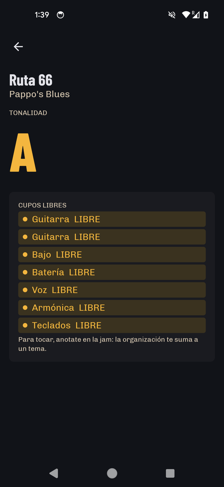 | 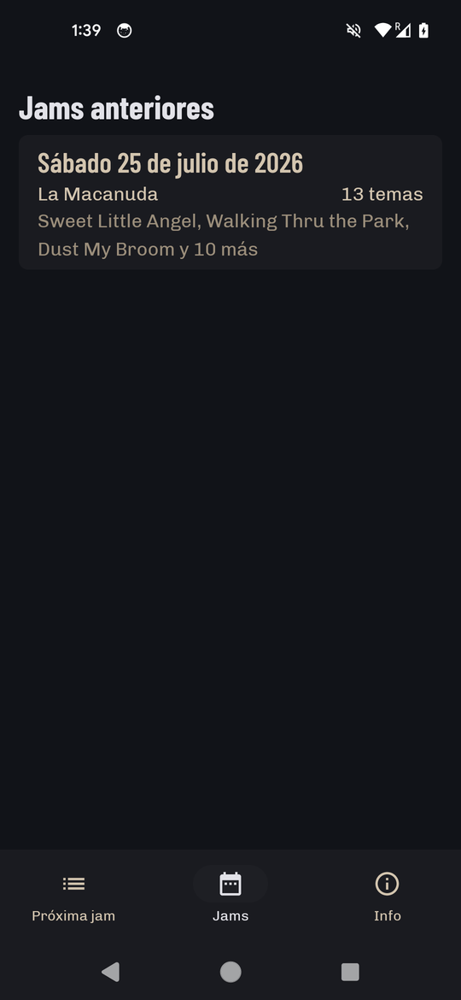 |
|:---:|:---:|

- **Detalle del tema:** título, artista y la tonalidad en tamaño grande. Abajo, los cupos: primero
  los libres, después los cubiertos y al final los **Otros** (quien toca fuera de la formación,
  como un saxo o percusión). Los Otros nunca cuentan como cupo.
- **Jams anteriores:** lista de la más nueva a la más vieja, con fecha, lugar, cantidad de temas y
  los primeros títulos. Al abrir una se ve la lista que se tocó.

### Info

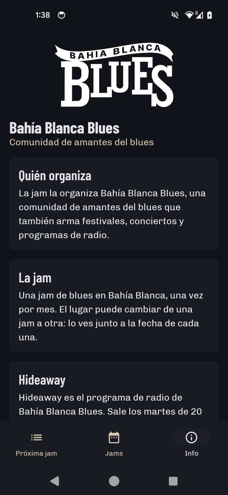

Presenta a la comunidad **Bahía Blanca Blues**: quién organiza, qué es la jam, el programa de radio
**Hideaway**, las redes y cómo sumarse.

## Modo admin

### Entrar y salir

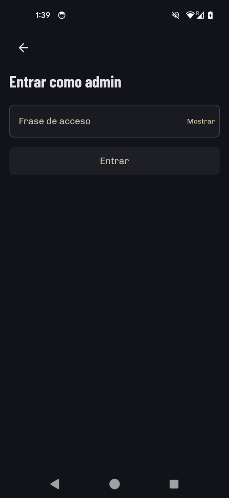

Cinco taps seguidos en el logo de Info abren el ingreso con frase de acceso. Con el modo admin
activo, otros cinco taps lo cierran. Los taps tienen que ser seguidos: si pasa más de un segundo y
medio entre uno y otro, la cuenta vuelve a empezar. La frase la valida el servidor; el modo admin
del teléfono solo decide qué controles se dibujan.

### Próxima jam y detalle del tema

| 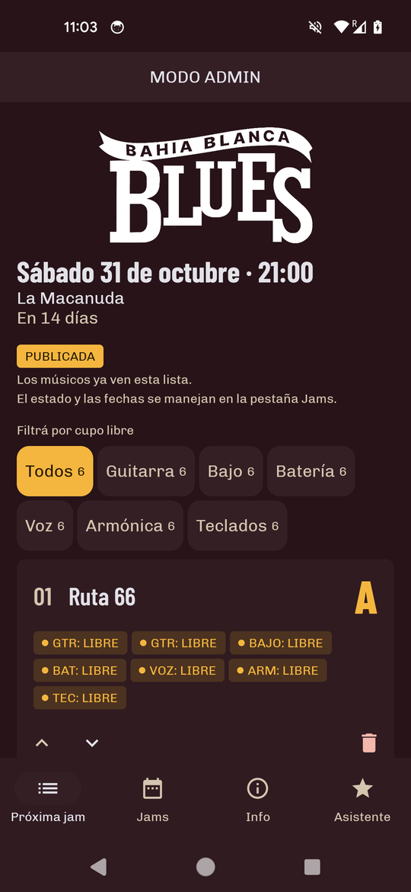 | 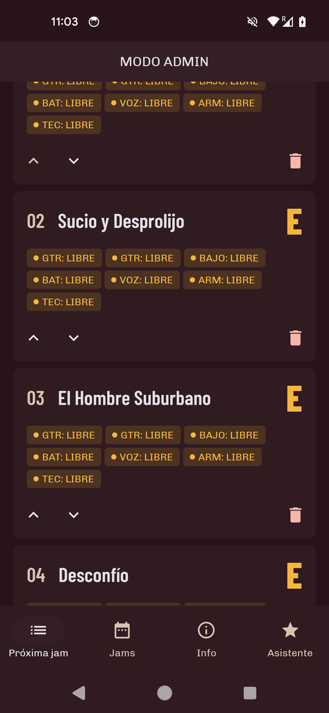 | 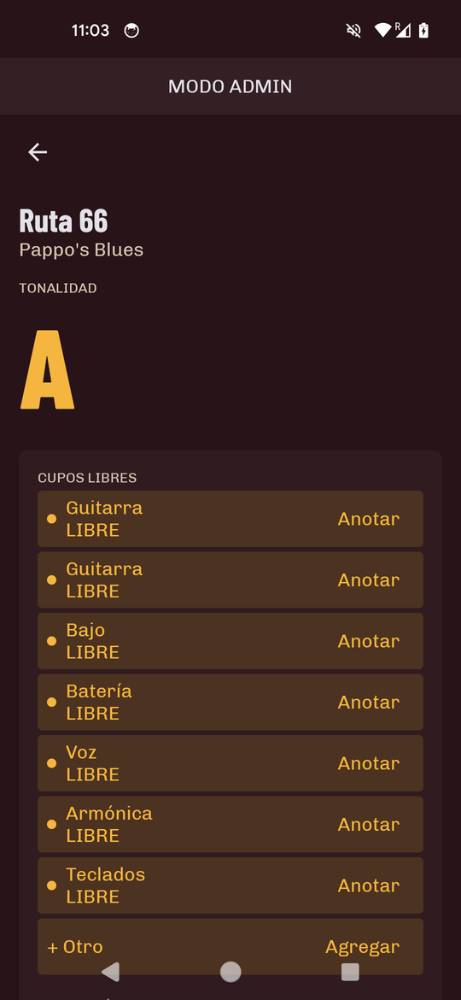 | 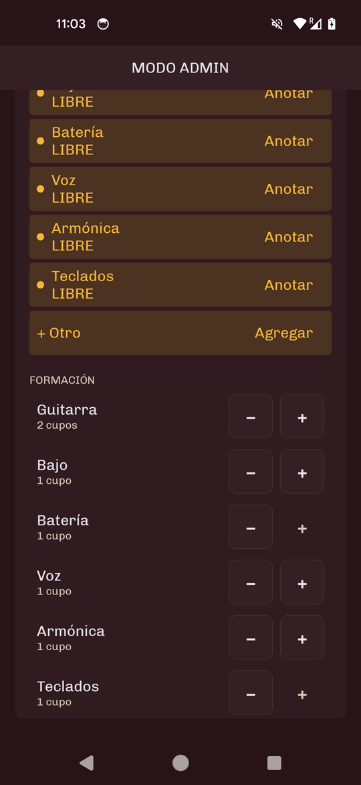 |
|:---:|:---:|:---:|:---:|

- **Lista:** cada fila suma una barra con Subir, Bajar y Quitar; quitar pide confirmar en un
  diálogo. Arriba de la lista está "Agregar tema", que busca en el catálogo.
- **Detalle del tema:**
  - **Anotar** a un músico en un cupo, con sugerencias de nombres de jams anteriores, y liberarlo;
  - tocar la tonalidad para cambiarla;
  - **ajustar la formación** de ese tema: cada instrumento va de 0 a 3 cupos, salvo Batería y
    Teclados, que llegan a 1;
  - agregar Otros con nombre e instrumento.

### Jams: crear, editar, publicar

| 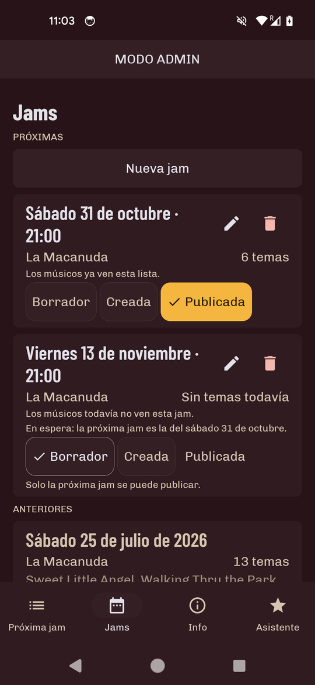 | 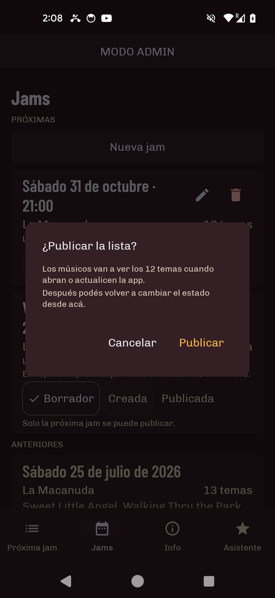 |
|:---:|:---:|

En la pestaña Jams, arriba de las anteriores, el admin ve las próximas y maneja todo lo relacionado
con las fechas:

- **Nueva jam:** fecha, hora y lugar.
- **Editar** fecha, hora y lugar con el lápiz. **Borrar** con el tacho, que siempre pide
  confirmación.
- **Estado** con chips de selección única:
  - **Borrador:** los músicos no ven la jam.
  - **Creada:** ven fecha, hora y lugar, y el aviso de que la lista se está armando.
  - **Publicada:** ven todo.
- Publicar pide confirmación en un diálogo. Despublicar también pide confirmación, porque los
  músicos dejan de ver la lista.
- Mientras se guarda un cambio de estado, los chips se deshabilitan y el borde del chip elegido
  pulsa.
- Si hay más de una jam futura, la más cercana es "la próxima" y las demás quedan en espera.

### Asistente

| 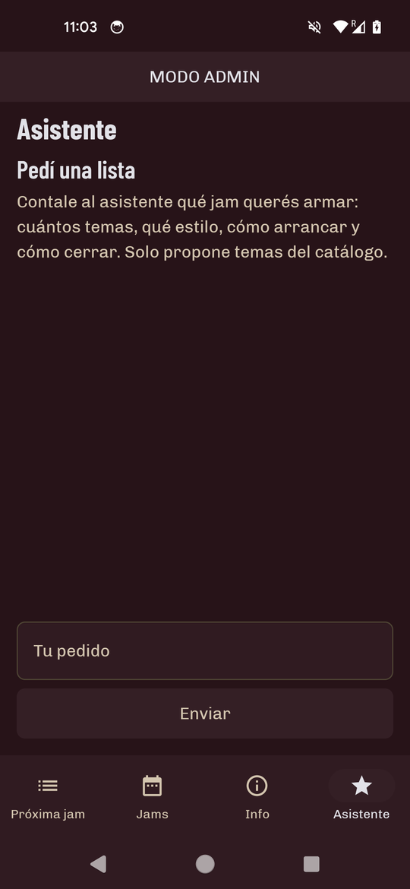 | 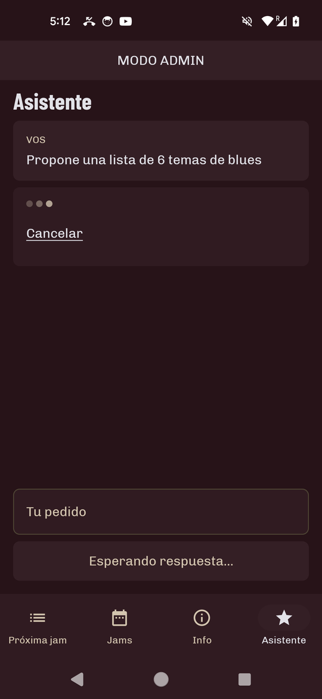 | 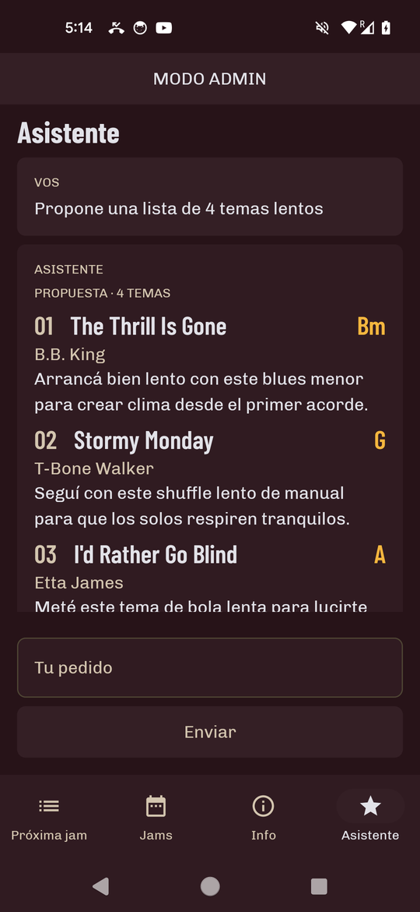 | 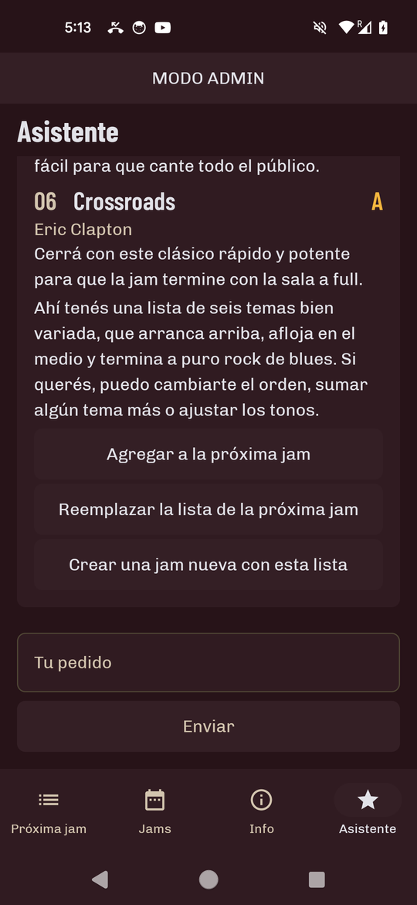 |
|:---:|:---:|:---:|:---:|

Es un chat. El admin pide la lista en una frase, por ejemplo:

> Generá una lista de temas de blues nacional, 12, con inicio y final bien arriba y temas más
> tranquis en el medio. Sumá algún tema que haya tocado Juan en alguna jam pasada.

- El agente consulta el **catálogo**, las **jams anteriores** y la **agenda** de próximas jams con
  herramientas de solo lectura y propone una lista ordenada. Cada tema trae tonalidad y un motivo.
  La respuesta cierra con un mensaje y, si el pedido es ambiguo, con preguntas.
- **Los temas van apareciendo de a uno** a medida que el modelo responde (streaming). Mientras
  espera, se ve una animación de puntos.
- **Solo propone temas del repertorio propio.** Cada tema se valida contra el catálogo antes de
  mostrarse, y lo que no está en el catálogo se descarta. Así se evita el punto débil del modelo:
  inventar títulos de blues nacional.
- **El asistente nunca escribe solo.** Cuando el admin confirma, la lista se usa de tres maneras:
  - **Agregar a la próxima jam**: suma los temas al final y saltea los repetidos;
  - **Reemplazar la lista de la próxima jam**: antes de confirmar, avisa qué se pierde;
  - **Crear una jam nueva con esta lista**: pide la fecha y propone la hora y el lugar de la
    última jam.
- La conversación se puede refinar ("cambiá el tercero por algo de Pappo"). Si el servicio de IA
  no responde, la app lo muestra con un aviso y Reintentar.

## Cómo funciona por dentro

```
 ┌──────────────┐   lee (GET anónimo)   ┌──────────────┐       ┌──────────────────┐
 │  App Android │ ────────────────────▶ │  Apps Script │  ───▶ │  Google Sheet    │
 │  (Compose)   │ ◀──────────────────── │  (validación │       │  catálogo, jams, │
 │              │   escribe (frase de   │   y lock)    │       │  una pestaña por │
 │              │   acceso, validada)   └──────────────┘       │  fecha           │
 │              │                                              └──────────────────┘
 │   Asistente  │ ── Koog (en el teléfono) ──▶ DevExpert Inference (compatible con OpenAI)
 └──────────────┘
```

- **Backend:** una **planilla de Google** con un Apps Script como intermediario. La planilla es la
  autoridad del catálogo y de las jams pasadas, y la app, de la lista de la próxima jam y su
  estado. No hay sincronización bidireccional: cada dato tiene un solo dueño.
- **Escrituras:** Apps Script valida en el servidor cada escritura, con la frase de acceso y un
  lock. El modo admin del teléfono solo decide qué controles se dibujan; no autoriza nada.
- **Offline:** la app guarda en caché local (Room) el catálogo y las jams, así que sin conexión
  sigue mostrando la última versión.
- **Asistente:** el agente corre en el teléfono con [Koog](https://github.com/JetBrains/koog), el
  framework de agentes de JetBrains para Kotlin. Llama a DevExpert Inference, un gateway compatible
  con OpenAI. El agente solo lee: aplicar una propuesta es un paso aparte que el admin confirma, y
  usa las mismas funciones del repositorio que los controles manuales: es el contrato de acciones,
  decidido antes de escribir código (ver la [bitácora](bb-blues-jam-bitacora.md)).

### Stack

Kotlin 2.3 · Jetpack Compose · Material 3 con tokens propios · arquitectura multimódulo · Koin ·
presenters composables sin ViewModels, testeados con Molecule · Room · DataStore · Navigation
Compose · OkHttp · Koog 1.3 · Konsist, detekt y ktlint en el gate.

```
:app                     wiring (Koin) y navegación
:core:model              tipos de dominio (Kotlin puro)
:core:data               repositorios, caché, cliente de Apps Script
:core:assistant          agente Koog, herramientas y streaming
:core:ui                 tema, tokens y componentes compartidos
:feature:next-jam        próxima jam y detalle del tema
:feature:past-jams       pestaña Jams
:feature:info            Info y entrada del admin
:feature:assistant       chat del asistente
:konsist-test            reglas de arquitectura (22), corren en el gate
backend/apps-script      Apps Script (Node tests)
```

Ningún módulo de feature depende de otro, y Konsist lo verifica en cada corrida del gate.

## Correrlo

Requisitos: Android Studio con JDK 17+ y un dispositivo o emulador con Android 7.0 (API 24) o
superior.

1. Configurá `local.properties`, que no se versiona:
   ```properties
   bluesjam.appsScriptUrl=https://script.google.com/macros/s/.../exec
   devexpert.key=...           # opcional: sin key, el asistente muestra "no configurado"
   bluesjam.demoUpcomingJam=true   # opcional, solo debug: jam de demo si la planilla no tiene una
   bluesjam.debugAdmin=true        # opcional, solo debug: arranca en modo admin sin la frase
   ```
   En un build de release estas opciones quedan siempre apagadas. El modo admin de debug solo dibuja
   los controles: el servidor sigue validando cada escritura con la frase. Para probar otros estados
   de la jam de demo están `bluesjam.demoUpcomingJamDraft`, `bluesjam.demoUpcomingJamCreated` y
   `bluesjam.demoUpcomingJamLive`.
2. Si querés tu propio backend, creá la planilla con el esquema de
   [`docs/sheet-schema.md`](docs/sheet-schema.md) y desplegá el script con
   [`backend/apps-script/README.md`](backend/apps-script/README.md).
3. Verificá e instalá:
   ```bash
   ./init.sh                      # build + tests + Konsist + detekt + ktlint
   ./gradlew :app:installDebug
   ```
4. Los tests del backend corren aparte, con Node 18 o superior y sin instalar nada:
   ```bash
   node --test backend/apps-script/test/*.test.js
   ```

## Documentación

| Documento | Contenido |
|---|---|
| [`docs/entregable-harness-ia.md`](docs/entregable-harness-ia.md) | Entregable del curso: el harness y el proceso con IA |
| [`docs/presentation/`](docs/presentation/) | Presentación del entregable: abrir `dist/index.html` en el navegador |
| [`bb-blues-jam-bitacora.md`](bb-blues-jam-bitacora.md) | Bitácora: el proceso y las 29 decisiones con su fundamento |
| [`docs/architecture.md`](docs/architecture.md) | Módulos, dependencias y flujo en ejecución, con diagrama |
| [`docs/feature-map.html`](docs/feature-map.html) | Mapa interactivo de las rebanadas y sus dependencias |
| [`docs/build-brief.md`](docs/build-brief.md) | Objetivos, MVP y no-objetivos |
| [`docs/phase-2-brief.md`](docs/phase-2-brief.md) | El asistente |
| [`docs/domain-model.md`](docs/domain-model.md) | Entidades, estados y autoridad de cada dato |
| [`docs/user-and-access-model.md`](docs/user-and-access-model.md) | Roles, frase de acceso y quién puede escribir |
| [`DESIGN.md`](DESIGN.md) | Tokens y reglas visuales |
| [`docs/apps-script-api.md`](docs/apps-script-api.md) | Contrato del backend |
| [`docs/sheet-schema.md`](docs/sheet-schema.md) | Esquema de la planilla |
