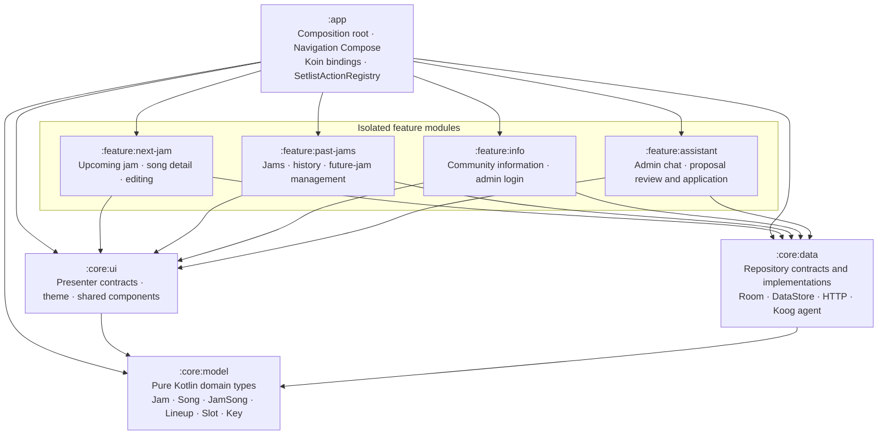
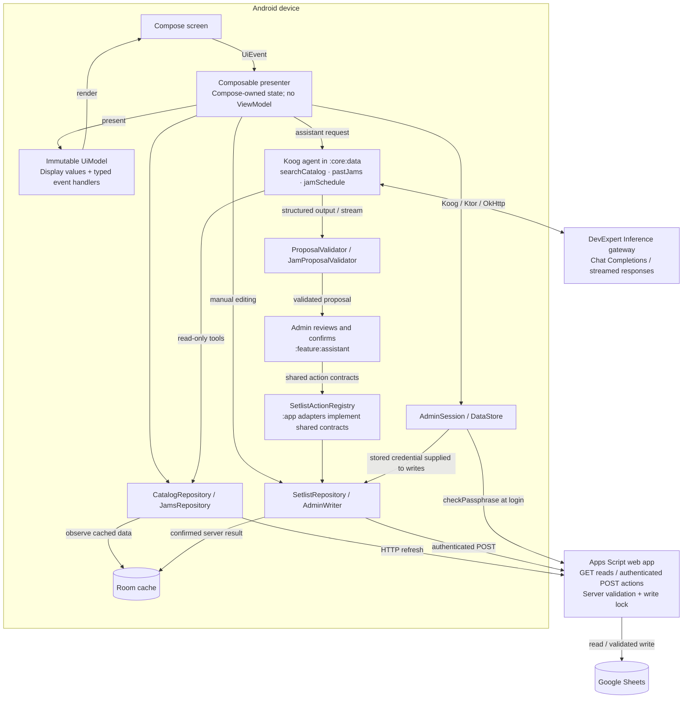

# Application architecture

Verified against the module definitions, composition root, repository bindings and agent tools
on 17 October 2026. The presentation-ready overview is [app-architecture.svg](diagrams/app-architecture.svg).
Solid arrows in that overview indicate module dependencies; dashed arrows indicate runtime HTTP
communication. The overview groups repeated dependencies to keep it readable. The exact direct
production-module dependencies are shown below.

## Module dependencies

There are eight production Gradle modules. `:konsist-test` is a separate test-only JVM module;
`build-logic` is an included build containing convention plugins. Neither is an application layer.
`backend/apps-script` is a separately deployed backend, not a Gradle module.

Feature modules have no dependencies on each other. Each currently declares `:core:ui` and
`:core:data`; both expose `:core:model` through `api`. `:core:data` does not depend on `:core:ui`.
Repository interfaces live in `:core:data`, not in the pure domain module. Navigation and concrete
bindings between shared contracts and application adapters live in `:app`.

## Runtime flow

Arrows in this diagram represent calls or emitted data, not Gradle dependencies.

The agent itself is read-only: its tools access the catalog, past jams and jam schedule. It cannot
reach a writing repository. Applying a proposal is a separate confirmed feature flow through
shared action contracts, whose adapters are wired in `:app` to `SetlistActionRegistry`. Manual
feature edits can call narrow repository contracts directly; they do not all pass through the
registry. Every supported mutation remains available through the action contract.

The local admin state controls which UI is rendered; Apps Script authenticates and validates
server actions. Room is a local cache, not an independent authority. The Sheet owns the catalog
and past jams; the app controls upcoming-setlist editing and publication through the backend,
which persists these changes in the Sheet. This is not bidirectional entity synchronization.

Optional music API enrichment is deferred and is deliberately absent from the implemented runtime
diagram. The Inference gateway is a remote service; Koog orchestration and validation run on the
device. Admin is state inside each feature, not a separate module.

## Verification and source references

Konsist enforces architectural boundaries. Molecule tests exercise composable presenters on the
JVM. `init.sh` invokes the project's build/check gate, including Konsist, detekt and ktlint. These
tools inspect the product; they are not runtime services.

- [Module declarations](../settings.gradle.kts) and each module's `build.gradle.kts`.
- [Composition root](../app/src/main/java/com/bbbjam/BluesJamApp.kt).
- [Application bindings](../app/src/main/java/com/bbbjam/di/AppModule.kt).
- [Data bindings](../core/data/src/main/kotlin/com/bbbjam/core/data/di/DataModule.kt).
- [Action registry](../app/src/main/java/com/bbbjam/actions/SetlistActionRegistry.kt).
- [Agent and registered tools](../core/data/src/main/kotlin/com/bbbjam/core/data/assistant/DefaultSetlistAssistant.kt).
- [Server action router](../backend/apps-script/src/Post.js).
- [Canonical architecture rules](../.claude/skills/architecture/SKILL.md) and [domain authority](domain-model.md).
