# Feature dependency graph

[Open the interactive map (HTML)](feature-map.html)

This graph visualizes every item in [`feature_list.json`](../feature_list.json). An arrow from A to B means B depends on A. Node colors show the current status recorded in that file.

Items: **75**. Status totals: **accepted: 74**, **blocked: 1**.

```mermaid
flowchart TD
  classDef accepted fill:#245c45,color:#fff,stroke:#8bd3aa
  classDef passing fill:#74520b,color:#fff,stroke:#f1c75b
  classDef in_progress fill:#174e79,color:#fff,stroke:#75b9ee
  classDef blocked fill:#702d32,color:#fff,stroke:#f08b92
  classDef not_started fill:#3f4650,color:#fff,stroke:#aab2bd
  f000["gradle-kotlin-compose-baseline<br/>Convert the scaffold to a Kotlin + Compose baseline"]
  f001["module-skeleton<br/>Create the multi-module skeleton with :core modules"]
  f002["konsist-isolation-rules<br/>Enforce feature module isolation with Konsist"]
  f003["detekt-ktlint-gate<br/>Wire detekt and ktlint into the check task"]
  f004["molecule-presenter-harness<br/>Set up the composable presenter pattern with a Molecule test"]
  f005["design-tokens-theme<br/>Implement the dark theme and design tokens"]
  f006["domain-model-types<br/>Define the domain types in :core:model"]
  f007["sheet-schema-definition<br/>Define the Sheet schema and document it"]
  f008["apps-script-read-endpoint<br/>Expose a read endpoint for the song catalog"]
  f009["apps-script-jams-read-endpoint<br/>Expose jams and setlists through Apps Script"]
  f010["catalog-repository-cache<br/>Read the catalog into a Room cache"]
  f011["jams-repository-cache<br/>Read jams and setlists into the cache"]
  f012["build-logic-conventions<br/>Introduce build-logic convention plugins"]
  f013["next-jam-read-only-list<br/>Show the next jam setlist collapsed"]
  f014["instrument-strip-component<br/>Add the instrument strip to each song row"]
  f015["song-row-expansion<br/>Expand a song row in place"]
  f016["instrument-filter-chips<br/>Filter the setlist by instrument with an open slot"]
  f017["list-states<br/>Implement the loading, empty, error and offline states"]
  f018["unpublished-setlist-state<br/>Hide a draft setlist from musicians"]
  f019["song-detail-screen<br/>Show the song detail screen"]
  f020["songsterr-browser-link<br/>Open the guitar tab in the browser"]
  f021["debug-demo-upcoming-jam<br/>Debug-only demo upcoming jam for device checks"]
  f022["past-jams-list<br/>List past jams in reverse chronological order"]
  f023["past-jam-detail<br/>Show a past jam read-only"]
  f024["info-screen<br/>Show the info screen"]
  f025["bottom-navigation<br/>Wire the three tabs into bottom navigation"]
  f026["admin-passphrase-login<br/>Log in as admin with a passphrase"]
  f027["debug-admin-session<br/>Debug-only admin session for device checks"]
  f028["apps-script-write-auth<br/>Validate the passphrase on every write endpoint"]
  f029["admin-add-song-to-setlist<br/>Add a song from the catalog to the setlist"]
  f030["admin-remove-song-from-setlist<br/>Remove a song from the setlist"]
  f031["admin-set-key<br/>Set the key on a scheduled song"]
  f032["admin-adjust-lineup<br/>Adjust a song's lineup"]
  f033["admin-edit-extra-participants<br/>Add and remove extra participants"]
  f034["admin-assign-musician<br/>Assign a musician to an open slot"]
  f035["admin-clear-slot<br/>Clear a filled slot"]
  f036["admin-reorder-songs<br/>Reorder songs in the setlist"]
  f037["admin-publish-setlist<br/>Publish the setlist"]
  f038["live-refresh-during-jam<br/>Refresh often during the jam, and pull to refresh"]
  f039["offline-notice-visible<br/>Keep the offline notice in view when it appears"]
  f040["action-contract-registry<br/>Register every mutation in one action contract"]
  f041["project-hygiene-pass<br/>Whole-project cleanliness review with no behavior change"]
  f042["ui-polish-pass<br/>Review every screen against DESIGN.md and the design prompt and implement the improvements"]
  f043["song-detail-replaces-row-expansion<br/>Remove the expanded row and move its logic into the song detail"]
  f044["admin-row-icon-actions<br/>Icon actions in the admin row bar and a dialog to confirm removal"]
  f045["lineup-grow-any-instrument<br/>Let the admin grow any instrument's slots up to three, with fixed Sheet columns"]
  f046["extras-dialog-and-lines<br/>Add Otros through a dialog and show each extra like a filled slot"]
  f047["admin-mode-highlight<br/>Make admin mode obvious with its own background and a MODO ADMIN banner"]
  f048["lineup-max-per-instrument<br/>Per-instrument slot ceilings: Batería and Teclados stay at one"]
  f049["strip-extra-chip-filled<br/>Show Otros in the song list strip as chips with the filled-slot background"]
  f050["kotlin-2-3-toolchain-upgrade<br/>Raise the Kotlin toolchain to 2.3 for phase 2"]
  f051["assistant-agent-core<br/>Koog setlist agent with catalog and past-jam tools"]
  f052["assistant-admin-tab<br/>Admin-only Asistente tab with the chat"]
  f053["assistant-apply-proposal<br/>Load the assistant's proposal into the upcoming setlist"]
  f054["assistant-create-jam<br/>The assistant proposes creating the next jam (date, time, venue)"]
  f055["jam-status-created<br/>Three jam states: BORRADOR hidden, CREADA date only, PUBLICADA full (D-26)"]
  f056["admin-set-jam-status<br/>The admin changes the jam status from the app (BORRADOR, CREADA, PUBLICADA)"]
  f057["admin-jams-tab<br/>The Anteriores tab becomes Jams: the admin manages upcoming jams there and creates a new one"]
  f058["admin-edit-delete-jam<br/>The admin edits the date, time and venue of the upcoming jam, or deletes it"]
  f059["assistant-proposal-targets<br/>Three ways to use the assistant's list: new jam, replace the upcoming list, add to it"]
  f060["jam-date-copy-polish<br/>Readable dates in the assistant's text and no 'agregala en la planilla' for an earlier date"]
  f061["assistant-streaming<br/>Stream the assistant's answer so songs appear one by one, with a loading animation"]
  f062["jam-status-chips<br/>Single-select status chips and edit/delete icons on the Jams tab cards"]
  f063["jam-status-chip-loading<br/>Animated chip border instead of the 'cambiando el estado' text while a status change sends"]
  f064["publish-confirm-dialog<br/>The publish confirmation becomes a dialog"]
  f065["admin-entry-logo-taps<br/>Enter and leave admin mode with five taps on the Info logo"]
  f066["feature-subpackages<br/>Split the large feature packages into per-flow subpackages"]
  f067["remove-action-registry<br/>Remove SetlistActionRegistry and bind the assistant's narrow contracts directly to SetlistRepository"]
  f068["typed-write-rejections<br/>Typed write rejections and shared write-failure copy"]
  f069["setlist-mutation-contracts<br/>One narrow contract per setlist mutation; features inject only what they use"]
  f070["setlist-mutation-engine<br/>Deduplicate the setlist mutation managers and split the setlist package"]
  f071["shared-test-fixtures<br/>Shared test fakes for feature modules"]
  f072["feature-api-surface<br/>Shrink each feature module's public API to what :app uses"]
  f073["wiring-and-preview-hygiene<br/>Required coordination dependencies and previews out of production screens"]
  f074["core-assistant-module<br/>Move the setlist assistant agent out of :core:data into :core:assistant"]
  f000 --> f001
  f001 --> f002
  f001 --> f003
  f001 --> f004
  f000 --> f005
  f001 --> f005
  f001 --> f006
  f006 --> f007
  f007 --> f008
  f008 --> f009
  f008 --> f010
  f006 --> f010
  f009 --> f010
  f010 --> f011
  f009 --> f011
  f001 --> f012
  f003 --> f012
  f010 --> f013
  f005 --> f013
  f004 --> f013
  f012 --> f013
  f011 --> f013
  f013 --> f014
  f014 --> f015
  f014 --> f016
  f013 --> f017
  f017 --> f018
  f015 --> f019
  f019 --> f020
  f019 --> f021
  f010 --> f022
  f005 --> f022
  f011 --> f022
  f022 --> f023
  f005 --> f024
  f013 --> f025
  f022 --> f025
  f024 --> f025
  f008 --> f026
  f005 --> f026
  f026 --> f027
  f021 --> f027
  f026 --> f028
  f028 --> f029
  f013 --> f029
  f029 --> f030
  f029 --> f031
  f029 --> f032
  f014 --> f032
  f032 --> f033
  f029 --> f034
  f015 --> f034
  f034 --> f035
  f029 --> f036
  f029 --> f037
  f018 --> f037
  f017 --> f038
  f017 --> f039
  f038 --> f039
  f030 --> f040
  f031 --> f040
  f032 --> f040
  f033 --> f040
  f035 --> f040
  f036 --> f040
  f037 --> f040
  f040 --> f041
  f041 --> f042
  f042 --> f043
  f043 --> f044
  f044 --> f045
  f045 --> f046
  f044 --> f047
  f045 --> f048
  f046 --> f048
  f048 --> f049
  f049 --> f050
  f050 --> f051
  f051 --> f052
  f052 --> f053
  f053 --> f054
  f054 --> f055
  f055 --> f056
  f056 --> f057
  f057 --> f058
  f058 --> f059
  f059 --> f060
  f060 --> f061
  f061 --> f062
  f062 --> f063
  f063 --> f064
  f026 --> f065
  f027 --> f065
  f040 --> f067
  f059 --> f067
  f068 --> f069
  f069 --> f070
  f070 --> f071
  f071 --> f072
  f072 --> f073
  f073 --> f074
  class f000 accepted
  class f001 accepted
  class f002 accepted
  class f003 accepted
  class f004 accepted
  class f005 accepted
  class f006 accepted
  class f007 accepted
  class f008 accepted
  class f009 accepted
  class f010 accepted
  class f011 accepted
  class f012 accepted
  class f013 accepted
  class f014 accepted
  class f015 accepted
  class f016 accepted
  class f017 accepted
  class f018 accepted
  class f019 accepted
  class f020 blocked
  class f021 accepted
  class f022 accepted
  class f023 accepted
  class f024 accepted
  class f025 accepted
  class f026 accepted
  class f027 accepted
  class f028 accepted
  class f029 accepted
  class f030 accepted
  class f031 accepted
  class f032 accepted
  class f033 accepted
  class f034 accepted
  class f035 accepted
  class f036 accepted
  class f037 accepted
  class f038 accepted
  class f039 accepted
  class f040 accepted
  class f041 accepted
  class f042 accepted
  class f043 accepted
  class f044 accepted
  class f045 accepted
  class f046 accepted
  class f047 accepted
  class f048 accepted
  class f049 accepted
  class f050 accepted
  class f051 accepted
  class f052 accepted
  class f053 accepted
  class f054 accepted
  class f055 accepted
  class f056 accepted
  class f057 accepted
  class f058 accepted
  class f059 accepted
  class f060 accepted
  class f061 accepted
  class f062 accepted
  class f063 accepted
  class f064 accepted
  class f065 accepted
  class f066 accepted
  class f067 accepted
  class f068 accepted
  class f069 accepted
  class f070 accepted
  class f071 accepted
  class f072 accepted
  class f073 accepted
  class f074 accepted
```

Features with no incoming dependency arrows are starting points. Features with multiple incoming arrows require every listed prerequisite to be accepted before they are ready, according to the project workflow.
